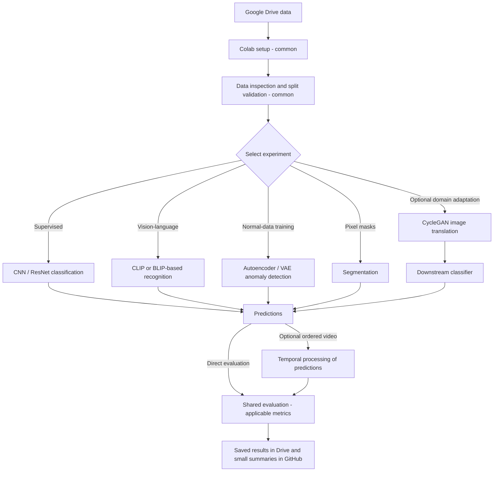

# Wildfire Detection in Drone Imagery with Little or No Labeled Data

## Project overview

`aerial-fire-vision` is our University of St. Thomas **SEIS 766 Vision AI** group project. Our research question is: **Can computer vision approaches reliably detect fire in aerial imagery when labeled training data is limited or unavailable?**

The current proposal centers on supervised fire classification, anomaly detection with limited labels, and zero-shot/few-shot visual recognition. We are interested in generalization across cameras and acquisition conditions, with image localization and video analysis as possible extensions. The experimental approach is still being refined.

**Current implementation:** the repository contains a Colab setup notebook that mounts Drive and checks a configurable directory. No models, dataset processing, experiments, or benchmark results have been implemented here. The research scope below follows the team's `ProjectProposal_draft.docx`, maintained outside this repository; proposed methods are not completed work.

## Repository organization

Current files, excluding Git's internal metadata:

```text
aerial-fire-vision/
├── README.md
├── .gitignore
└── notebooks/
    └── starter.ipynb
```

`README.md` is the project reference; `.gitignore` excludes common local data, secrets, caches, and artifacts.[`notebooks/starter.ipynb`](notebooks/starter.ipynb) contains only Drive setup, a path check, and an empty team workspace.

- **GitHub:** canonical notebooks, source code, documentation, and small configuration files.
- **Google Drive:** source of truth for datasets, original videos, checkpoints, and larger experimental artifacts.
- **Google Colab:** primary environment for executing `.ipynb` notebooks.

Never commit datasets, model weights, credentials, or other large files. Review notebook cells and outputs before saving; `.gitignore` cannot remove sensitive content embedded in a notebook.

## Getting started

1. Clone the repository with `git clone https://github.com/DavidBraun777/aerial-fire-vision.git`, or open [Google Colab](https://colab.research.google.com/), choose **File → Open notebook → GitHub**, paste the repository URL, and select `notebooks/starter.ipynb` from the appropriate branch.
2. Obtain access to the team's shared Drive folder. One teammate should create a folder named `aerial-fire-vision`, share it with the group, and distribute its link. **TODO:** confirm the shared folder and access arrangements; this repository does not establish that data has been uploaded.
3. Add a shortcut to that folder at the top level of your own **My Drive**, using the name `aerial-fire-vision`. The owner can use the original folder if it is already there. Run the notebook's setup cells in order and mount **your own Google Drive account** when prompted.
4. Check the editable path in the notebook: `DATA_DIR = Path("/content/drive/MyDrive/aerial-fire-vision")`. Account configurations and Drive layouts differ; change `DATA_DIR` if your shortcut or shared folder appears elsewhere.
5. Run the directory check. It confirms that the folder exists, not that the dataset is complete. Once files are available, inspect the folder and confirm the required files can be opened before beginning an experiment.
6. Create a separate Git branch for your work, such as `docs/dataset-notes` (`git switch -c docs/dataset-notes` locally, or use GitHub's branch selector). Save notebook edits to that branch with Colab's **File → Save a copy in GitHub**, or download the `.ipynb` and commit/upload it to the same repository path. Clear outputs, review the diff, and open a pull request to the default branch with a short explanation. Ask a teammate to review before merging.

A notebook opened from GitHub and a copy saved in Google Drive may be different files. Editing a Drive copy does not update GitHub automatically. **GitHub remains the canonical copy of team notebooks**; return changes through a branch and pull request. See the [Colab FAQ](https://research.google.com/colaboratory/faq.html) for notebook storage and runtime behavior.

## Dataset

The proposal selects the [FLAME dataset on IEEE DataPort](https://ieee-dataport.org/open-access/flame-dataset-aerial-imagery-pile-burn-detection-using-drones-uavs), collected during a prescribed pile burn in an Arizona pine forest. This is a candidate setting for our wildfire-detection research; results on these recordings alone would not establish generalization to all wildfire conditions. Download status and the team's Drive organization are **to be verified**.

The proposal's classification counts agree with Table 2 of the [original FLAME paper](https://arxiv.org/html/2012.14036):

| Subset | Records | Resolution |
|---|---:|---|
| Classification train/validation | 39,375 | 254 × 254 |
| Classification test | 8,617 | 254 × 254 |
| Segmentation | 2,003 images + 2,003 masks | Verify actual file dimensions |

Class distributions in the proposal and paper:

- Train/validation: **25,018 Fire**, **14,357 No_Fire**.
- Test: **5,137 Fire**, **3,480 No_Fire**.

Raw videos preserve recording order; extracted frames are individual images sampled from those videos. Classification labels describe fire presence in an entire frame. Segmentation masks identify fire pixels and must be paired with the correct images. Consecutive frames can be highly correlated and are not necessarily independent observations.

The publication uses **Zenmuse X4S footage from a Matrice 200** for classification training/validation and **Phantom footage** for testing. It also states that the segmentation images were selected from fire frames in the classification test set. This creates a leakage risk if segmentation data informs a classifier evaluated on that test set. See [the paper, Sections 3.2 and 4](https://arxiv.org/html/2012.14036).

**To be verified:** the proposal lists segmentation resolution as **3840 × 2160**, while the paper's Table 2 lists **3480 × 2160**. The paper separately reports raw Phantom video at 3840 × 2160. Inspect the downloaded image/mask dimensions, pairing, mask encoding, and frame identities before choosing a preprocessing size or split; do not silently resolve the discrepancy.

## Research questions

1. How does a fully supervised CNN perform as a reference baseline? The proposal suggests a fine-tuned ResNet using all available training labels.
2. Can an autoencoder or VAE trained on `No_Fire` examples detect fire as an anomaly? The proposal also asks whether reconstruction errors could provide useful localization.
3. How effectively can CLIP perform zero-shot and few-shot fire classification, and how many labels are needed to approach the supervised reference? The proposal suggests exploring 10–100 labeled examples; exact budgets and sampling remain open.
4. How well do these approaches generalize between camera sources?

Possible extensions include BLIP/BLIP-2 for vision-language understanding, DINOv2 or other self-supervised representations, semantic segmentation, temporal analysis, and CycleGAN image-domain translation. These are optional investigations, not commitments to implement every method. BLIP-based recognition would need an explicit prediction/scoring protocol; it is not automatically the same experiment as CLIP classification.

## Proposed notebook workflow

The following is a conceptual outline for future work; only Drive setup and a directory check exist today:

1. Environment and imports.
2. Google Drive mounting and configurable paths.
3. Dataset inspection and metadata.
4. Image/video preprocessing.
5. Dataset splitting and sampling.
6. Select an experimental approach.
7. Model training or inference, where applicable.
8. Evaluation.
9. Visualizations and error analysis.
10. Saving results and run metadata.

Keep shared inspection, preprocessing, split definitions, and evaluation distinct from model-specific cells. Establish split boundaries before fitting preprocessing or applying augmentation. Use explicit `DATA_DIR`, `OUTPUT_DIR`, and random seed variables; record sample IDs, label budgets, settings, package versions, and the relevant Git revision with results. Save large artifacts in Drive.

One readable notebook is sufficient for initial inspection and a small baseline. Separate model notebooks may become preferable when dependencies, runtime needs, or simultaneous editing make one notebook difficult to maintain. They should retain comparable splits and evaluation conventions. Add dependencies only when an experiment requires them; no shared training engine or tracking service is needed at this stage.

## Possible architectures

This diagram describes **proposed alternatives**, not an implemented pipeline. Setup, data validation, evaluation, and saving are common stages. The model branches are exploratory choices; temporal processing and CycleGAN adaptation are optional.



CycleGAN would be evaluated through a downstream task and checked for preservation of fire content. Any use of target-camera images for adaptation must be declared separately from evaluation on an untouched camera source. Temporal processing requires reliable sequence order. Shared evaluation does not mean every branch supports the same output type or metric.

## Evaluation considerations

- **Evaluation unit and leakage:** distinguish frame-level classification from video-level decisions, and define any temporal aggregation before testing. Random frame splits can place near-duplicate neighboring frames in training and validation. Prefer grouping by recording or temporally separated segments, with an appropriate gap where possible. If sequence metadata cannot be recovered, document that limitation rather than assuming independence.
- **Partition overlap:** preserve the held-out classification test set. Audit filenames, source sequences, and image similarity across partitions, including segmentation images drawn from test footage. Do not use held-out test labels for training, prompt or threshold tuning, early stopping, or model selection. Define a separate segmentation protocol if that extension proceeds.
- **Class imbalance and metrics:** report class counts, accuracy, fire-class precision, recall, and F1. Use continuous scores for ROC-AUC and PR-AUC, stating the positive class and averaging conventions. Choose thresholds using validation data. Accuracy alone can hide missed fires or excessive false alarms.
- **Label budgets:** compare methods on the same held-out examples, with declared training and validation label counts and repeatable sampling. Report pretrained models and any adaptation. Training a VAE only on known `No_Fire` images still uses labels to select normal data. For zero-shot evaluation, avoid tuning prompts on held-out test labels; a pretrained model is not a model trained without any prior data.
- **Camera shift:** report source-camera validation and held-out-camera results separately. Different cameras also capture different views and conditions, so a performance difference cannot automatically be attributed to camera hardware alone.
- **Localization:** segmentation IoU requires valid pixel-level predictions and aligned ground-truth masks, plus a stated threshold and aggregation rule. Image-level class predictions or unvalidated reconstruction heatmaps do not establish segmentation performance.
- **Speed:** record processing speed and inference latency alongside hardware, image size, batch size, and preprocessing. Distinguish model inference time from Drive I/O and end-to-end runtime; report video aggregation delay if applicable.

No team benchmark scores are available yet.

## Project plan

This plan is editable. Status describes work evidenced in this repository; ownership is unassigned.

| Phase | Status | Next outcome |
|---|---|---|
| Dataset access and verification | Planned | Confirm access, contents, counts, dimensions, and provenance |
| Initial exploratory data analysis | Planned | Inspect examples, labels, masks, and sequence metadata |
| Baseline experiments | Planned | Agree on splits and run the selected reference methods |
| Comparison of methods | Planned | Compare label budgets, camera generalization, and speed |
| Optional extension experiments | Not started; scope undecided | Select only extensions supported by time and evidence |
| Evaluation and error analysis | Planned | Review false alarms, missed fires, and limitations |
| Final report and presentation | Planned | Document methods, comparisons, references, and reproducibility |

The course syllabus, `VAI_0_Syllabus_26F.pdf` (pages 6 and 8, maintained outside this repository), lists:

- **October 27, 2026:** project plan due.
- **December 8, 2026:** project presentation; slides due before the presentation.
- **December 19, 2026:** final project due.

These dates come from the syllabus's tentative schedule; check Canvas for course updates.

## Open decisions

- Exact dataset downloads, access requirements, and shared Drive organization.
- Required experiments versus optional extensions.
- Whether source-video identities and frame order can be reconstructed.
- Validation splits that avoid temporal leakage and cross-task overlap.
- Whether segmentation is within scope, and how its dimensions and masks will be verified.
- Shared metrics, thresholds, label budgets, and repeated-sampling protocol.
- Notebook ownership, coordination of simultaneous edits, and pull request review responsibilities.

## References

Primary dataset and research sources; inclusion does not imply an implementation choice:

- [FLAME dataset, IEEE DataPort](https://ieee-dataport.org/open-access/flame-dataset-aerial-imagery-pile-burn-detection-using-drones-uavs).
- Shamsoshoara et al., [*Aerial Imagery Pile Burn Detection Using Deep Learning: The FLAME Dataset*](https://arxiv.org/abs/2012.14036); [journal publication](https://doi.org/10.1016/j.comnet.2021.108001) and [authors' code](https://github.com/AlirezaShamsoshoara/Fire-Detection-UAV-Aerial-Image-Classification-Segmentation-UnmannedAerialVehicle).
- He et al., [*Deep Residual Learning for Image Recognition* (ResNet)](https://arxiv.org/abs/1512.03385).
- Kingma and Welling, [*Auto-Encoding Variational Bayes* (VAE)](https://arxiv.org/abs/1312.6114).
- Radford et al., [*Learning Transferable Visual Models From Natural Language Supervision* (CLIP)](https://arxiv.org/abs/2103.00020).
- Li et al., [*BLIP: Bootstrapping Language-Image Pre-training for Unified Vision-Language Understanding and Generation*](https://arxiv.org/abs/2201.12086), and [*BLIP-2: Bootstrapping Language-Image Pre-training with Frozen Image Encoders and Large Language Models*](https://arxiv.org/abs/2301.12597).
- Oquab et al., [*DINOv2: Learning Robust Visual Features without Supervision*](https://arxiv.org/abs/2304.07193).
- Zhu et al., [*Unpaired Image-to-Image Translation using Cycle-Consistent Adversarial Networks* (CycleGAN)](https://arxiv.org/abs/1703.10593).
