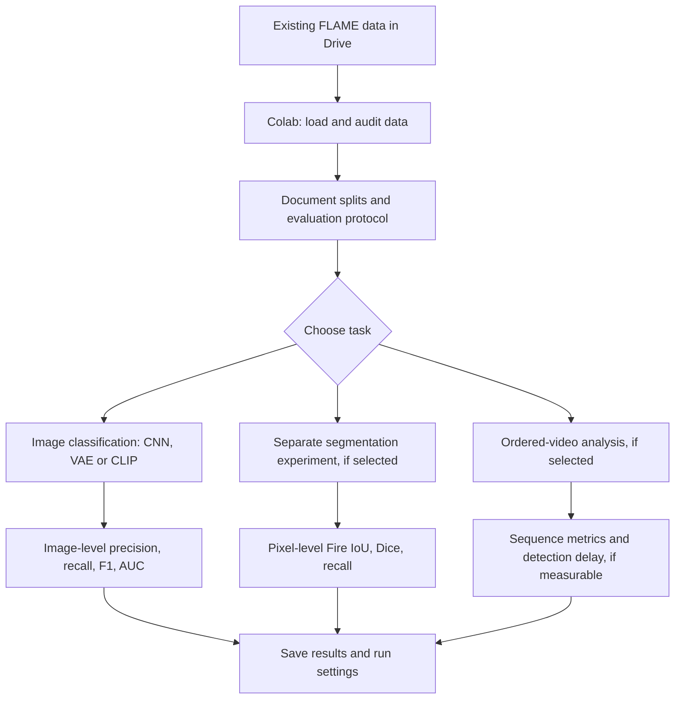

# Wildfire Detection in Drone Imagery with Little or No Labeled Data

`aerial-fire-vision` is the **Visionaries' SEIS 766 Vision AI group project** at the University of St. Thomas (Fall 2026).

**Research question:** How well can computer vision methods recognize visible fire in aerial imagery when few or no *task-specific* training labels are available?

**Scope:** This is an offline study using the existing [FLAME dataset](https://doi.org/10.21227/qad6-r683). **Our team did not fly drones or collect new imagery.** The original FLAME researchers recorded RGB and thermal footage with drones during a prescribed pile burn in an Arizona pine forest. Results on this dataset alone do not establish reliable detection of uncontrolled wildfires or real-time deployment.

The proposed core comparison is a supervised CNN, a VAE trained on known `No_Fire` images, and CLIP with zero-shot/few-shot approaches. These are research plans, **not results**. The methods and scope may change as the team examines the data.

## Repository and collaboration

This shared `master` branch is intentionally small:

```text
aerial-fire-vision/
├── .gitignore
├── README.md
└── notebooks/
    └── starter.ipynb
```

- **GitHub:** source of truth for notebooks, code, and documentation.
- **Google Drive:** planned shared storage for original datasets, models, and larger results.
- **Google Colab:** primary environment for running the Jupyter notebooks.

The [starter notebook](notebooks/starter.ipynb) only mounts Google Drive, configures a folder path, and checks that the folder exists. **It does not load or validate FLAME, train models, or report benchmark results.**

### Getting started

1. Open [`notebooks/starter.ipynb`](notebooks/starter.ipynb) in [Google Colab](https://colab.research.google.com/) using **File → Open notebook → GitHub**, or clone this repository locally.
2. Obtain access to the team's FLAME data folder. The shared Google Drive location and teammate access **have not yet been confirmed**.
3. If the folder is shared with you, add a shortcut named `aerial-fire-vision` to **My Drive**, or adapt the notebook's `DATA_DIR` to match your own Drive layout.
4. Run the notebook setup cells. The configured path is `/content/drive/MyDrive/aerial-fire-vision` by default. A successful path check only confirms that the folder exists, not that all data is present.
5. Make changes on your own Git branch and propose them for review before merging into `master`. Avoid editing the same notebook simultaneously; clear large cell outputs before committing.

Do not commit datasets, videos, model weights, credentials, or generated artifacts to Git. Changes made to a Drive copy of a notebook do not automatically update the GitHub version.

## Dataset: FLAME

FLAME (*Fire Luminosity Airborne-based Machine learning Evaluation*) provides extracted RGB frames and original RGB/thermal recordings. The core archives are `Training.zip`, `Test.zip`, `Images.zip`, and `Masks.zip`. The original study reports:

| Subset | Records | Source / details |
|---|---:|---|
| Classification train/validation | 39,375 RGB frames (25,018 `Fire`; 14,357 `No_Fire`) | Zenmuse X4S footage; 254 × 254 |
| Classification test | 8,617 RGB frames (5,137 `Fire`; 3,480 `No_Fire`) | Phantom footage; 254 × 254 |
| Segmentation | 2,003 RGB frames and 2,003 matching mask files | Frames from the Phantom fire footage; resolution discrepancy noted below |

**Acquisition status:** The full set of six source recordings and four image archives has been downloaded locally for preliminary inspection **outside this repository**. The `Test.zip` archive has been audited and its reported image counts and dimensions verified; the masks have also been inspected. **A complete audit of every source file, RGB–mask alignment, and shared Google Drive access is still pending.** No data files are published here.

**Segmentation dimensions:** The downloaded `Masks.zip` contains 2,003 masks at **3840 × 2160**, with observed binary pixel values `0` (background) and `1` (fire). Table 2 in the 2021 paper instead lists **3480 × 2160** for segmentation. The corresponding RGB image dimensions and alignment still need verification. Mask values should not be divided by 255; resize label masks with nearest-neighbor interpolation.

These are **frames from a small number of recordings, not independent wildfire events**. Nearby frames can be nearly identical. The classification training and test sets also come from different acquisition setups, so test performance may reflect changes in camera, viewpoint, timing, and scene conditions—not camera hardware alone.

A preliminary test-archive audit also identified **nine completely black `No_Fire` frames**. Keep the official archive unchanged; any decision to exclude these frames should be declared and results reported consistently.

### Data use

The original archives should be treated as read-only inputs. Once shared Drive access is established, a possible layout is:

```text
aerial-fire-vision/
└── datasets/
    └── FLAME/
        └── archives/
            ├── Training.zip
            ├── Test.zip
            ├── Images.zip
            └── Masks.zip
```

This is a **suggested Drive layout**, not a claim that it exists. In Colab, copy archives into the temporary runtime before extracting large numbers of small images, and save only the outputs you need back to Drive. Keep a record of archive checksums and splits used for experiments.

## Proposed experiments

| Approach | What we want to learn | Supervision |
|---|---|---|
| **CNN / ResNet** | A reference Fire/No_Fire classifier and its performance with limited labels | Full or sampled training labels |
| **VAE anomaly detection** | Whether reconstruction error from `No_Fire` training images helps detect fire | Known normal-class selection; no fire examples required for training |
| **CLIP** | How zero-shot image–text recognition compares with few-shot adaptation | No FLAME-specific labels for zero-shot; declared budgets for few-shot |

For the label-efficiency comparison, we plan to evaluate the same held-out examples and use matched, reproducible label budgets (for example 10, 25, 50, and 100 per class). CLIP is pretrained; *zero-shot* means no FLAME-specific training labels, not a model trained with no prior supervision.

Possible extensions—not commitments—include fire-pixel segmentation, temporally consistent video predictions, DINOv2 or BLIP, and image-domain adaptation. We will decide on extensions after establishing working baselines.

### Experimental workflow (proposed)



This diagram describes possible paths, **not an implemented pipeline**.

## Evaluation rules

- **Protect the test partition.** Use training/validation data to select models, prompts, preprocessing, hyperparameters, and decision thresholds. Use the original 8,617-frame test set only for final evaluation under a frozen protocol; data-quality audits are documented separately.
- **Address correlated video frames.** Prefer source-video or temporally separated validation when source metadata permits. Do not infer original chronology solely from separate class-specific filename sequences.
- **Keep the tasks separate.** The 2,003 segmentation images were drawn from Phantom fire footage that also supplied the classification test set. A segmentation model trained on those frames cannot then be claimed to be an unseen-camera evaluation on that same footage.
- **Use appropriate metrics.** Report Fire-class precision, recall, F1, and accuracy, plus ROC-AUC and PR-AUC where valid. For segmentation, report pixel-level Fire IoU and Dice. Record inference latency and the compute environment where practical.
- **Be precise about the claims.** A VAE reconstruction heatmap is not automatically a fire mask; a high frame-level score does not identify fire pixels; and good results on prescribed pile burns do not prove operational wildfire detection.

## Project status and next steps

| Work item | Status |
|---|---|
| Shared repository and Colab starter | Available; Drive folder check only |
| FLAME source files | Downloaded locally outside Git; partial audits completed |
| Team-wide Google Drive access | Not yet confirmed |
| Shared data manifest and evaluation split | To be agreed and validated |
| Models and experimental results on `master` | Not implemented |

Next: confirm team access to the archives, validate file integrity and image–mask pairs, agree on label conventions and splits, then run a simple baseline before expanding the model comparison.

The course's tentative schedule lists the **project plan (October 27, 2026)**, **presentation (December 8, 2026)**, and **final submission (December 19, 2026)**. Check Canvas for updates.

## Original resources and references

- **Dataset and files:** [FLAME on IEEE DataPort](https://ieee-dataport.org/open-access/flame-dataset-aerial-imagery-pile-burn-detection-using-drones-uavs) · [Dataset DOI: 10.21227/qad6-r683](https://doi.org/10.21227/qad6-r683)
- **Published paper:** Shamsoshoara et al., [*Aerial imagery pile burn detection using deep learning: The FLAME dataset*](https://doi.org/10.1016/j.comnet.2021.108001), *Computer Networks* (2021) · [arXiv preprint](https://arxiv.org/abs/2012.14036)
- **Original implementation:** [FLAME classification and segmentation GitHub repository](https://github.com/AlirezaShamsoshoara/Fire-Detection-UAV-Aerial-Image-Classification-Segmentation-UnmannedAerialVehicle) (legacy TensorFlow/Keras code; inspect it critically rather than assuming its results reproduce unchanged)
- **Initial method references:** [ResNet](https://arxiv.org/abs/1512.03385) · [VAE](https://arxiv.org/abs/1312.6114) · [CLIP](https://arxiv.org/abs/2103.00020)

Dataset, paper, and upstream code may have different reuse terms. Check the specific source's license before redistributing data or adapting upstream code.
