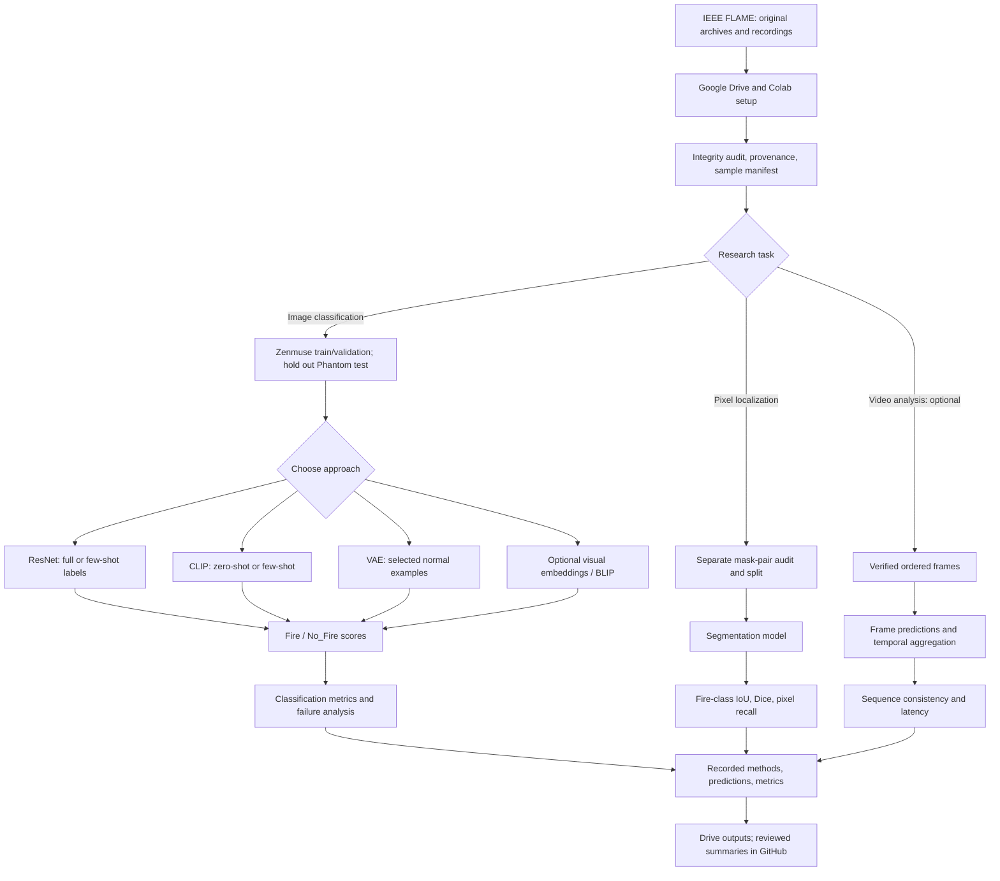

# Wildfire Detection in Drone Imagery with Little or No Labeled Data

**University of St. Thomas · SEIS 766 — Vision AI · Fall 2026 · The Visionaries**

## Project overview

`aerial-fire-vision` is our group's research project investigating **visible-fire recognition in aerial imagery under limited task-specific labeling**. Our central question is:

> **How do supervised, anomaly-based, and vision–language approaches compare when the number of labeled training images is restricted, particularly across different image-acquisition conditions?**

The proposed comparison uses a supervised convolutional neural network (CNN) as a reference, a variational autoencoder (VAE) for normal-data anomaly detection, and CLIP for zero-shot and few-shot recognition. Pixel-level segmentation, video analysis, and other methods remain possible extensions, not required deliverables.

**Study scope and provenance.** Our team did **not** conduct drone flights or collect original imagery. We are working with the existing [FLAME dataset](https://doi.org/10.21227/qad6-r683), whose original researchers collected RGB and thermal footage using UAV-mounted cameras during a prescribed pile burn in an Arizona pine forest. Here, *drone imagery* describes the **source of the dataset**, not our team's activities. FLAME can support a controlled research comparison, but results on a single prescribed-burn setting should not be represented as validation of real-time wildfire surveillance or deployment.

**Implementation status.** The shared repository currently contains documentation and a minimal Google Colab starter notebook. It does not yet contain a trained fire detector, validated end-to-end dataset pipeline, or team benchmark results. Proposed architectures and experiments below are plans, not completed work.

## Repository organization and collaboration

The shared repository is intentionally small while the team agrees on methods and responsibilities.

```text
aerial-fire-vision/
├── .gitignore
├── README.md
└── notebooks/
    └── starter.ipynb
```

| Component | Purpose |
|---|---|
| **GitHub** | Canonical notebooks, source code, documentation, and small reproducible configurations |
| **Google Drive** | Planned shared storage for dataset archives, model checkpoints, and larger outputs |
| **Google Colab** | Primary notebook execution environment; GPU use when available |

`README.md` is the project reference, and `.gitignore` protects against accidentally adding common local data, environment files, model weights, and generated artifacts. [`notebooks/starter.ipynb`](notebooks/starter.ipynb) currently **only** mounts Drive, configures a path, and checks for a directory. That check does not verify dataset completeness.

### Getting started

1. Clone the repository, or open [Google Colab](https://colab.research.google.com/) and select **File → Open notebook → GitHub**. Use `https://github.com/DavidBraun777/aerial-fire-vision` and open [`notebooks/starter.ipynb`](notebooks/starter.ipynb).
2. Obtain access to the team's data folder. **Shared Google Drive access is not yet confirmed.** Once it is shared, add a shortcut named `aerial-fire-vision` to **My Drive**, or use the path appropriate for your account.
3. Mount your own Drive in Colab and inspect the editable setting: `DATA_DIR = Path("/content/drive/MyDrive/aerial-fire-vision")`. Confirm the required files exist; the starter's folder check alone is insufficient.
4. Work in a separate Git branch, keep notebooks reviewable, and propose changes through a pull request. Avoid simultaneous editing of one notebook and remove bulky cell outputs before committing.

GitHub is the source of truth for notebooks and code; saving a copy to Drive does **not** update GitHub. Do not commit raw data, videos, model weights, secrets, or credentials. `.gitignore` cannot protect information embedded inside notebook cells or outputs.

See [Google Colab's FAQ](https://research.google.com/colaboratory/faq.html) for runtime and Drive behavior.

## Dataset and provenance

The primary source is **FLAME — Fire Luminosity Airborne-based Machine learning Evaluation**, available through [IEEE DataPort](https://ieee-dataport.org/open-access/flame-dataset-aerial-imagery-pile-burn-detection-using-drones-uavs). It includes extracted RGB frames, image-level Fire/No_Fire labels, pixel-level segmentation masks, and original RGB and thermal recordings.

### Published dataset partitions

| Dataset subset | Number of records | Known source | Resolution |
|---|---:|---|---|
| Classification — training/validation | **39,375** images | Zenmuse X4S | 254 × 254 |
| Classification — test | **8,617** images | Phantom | 254 × 254 |
| Segmentation | **2,003** RGB images and **2,003** masks | Selected from Phantom fire footage | Masks: 3840 × 2160 observed; RGB pairing/dimensions pending verification |
| Original recordings | **3 RGB** and **3 thermal-palette** videos | Original FLAME capture | Varies by recording |

The classification class counts are:

| Split | `Fire` | `No_Fire` | Total | Fire proportion |
|---|---:|---:|---:|---:|
| Training/validation | 25,018 | 14,357 | 39,375 | 63.5% |
| Test | 5,137 | 3,480 | 8,617 | 59.6% |

These figures describe **video-derived frames, not independent fires or separate field campaigns**.

### Files, access, and current verification

The dataset's original ZIP archives are `Training.zip`, `Test.zip`, `Images.zip`, and `Masks.zip`. Six source recordings are also available, including Zenmuse, Phantom, and rendered thermal videos.

A team member has downloaded the complete collection locally **outside this GitHub repository**. Preliminary local inspection has verified the counts and 254 × 254 RGB format of the test frames and inspected the 2,003 segmentation masks. **Team-wide Drive sharing, a complete full-dataset audit, and RGB-image-to-mask alignment are still pending.** Nothing in this repository implies that the files can already be accessed by every teammate.

The downloaded masks are **3840 × 2160**, with `0` representing background and `1` representing fire. The original paper's Table 2 instead lists **3480 × 2160** for segmentation. This discrepancy must be reported rather than silently corrected; confirm the paired RGB dimensions before training or measuring IoU. Do not divide already-binary `0`/`1` masks by 255. Use nearest-neighbor interpolation for label masks.

Preliminary local quality checks also flagged **nine black `No_Fire` test frames**, and very small fire regions within many segmentation masks. Preserve the original data and document any quality exclusions or sensitivity analyses rather than quietly modifying the benchmark.

### Dataset limitations that matter experimentally

- **Frame correlation:** thousands of nearby frames can depict almost identical scenes. A random train/validation split risks inflating results through near-duplicate overlap.
- **Acquisition shift:** classification training/validation footage and testing footage come from different camera setups. Changes in viewpoint, timing, lighting, and scene content may be confounded with camera differences.
- **Cross-task overlap:** the segmentation examples were selected from Phantom fire footage associated with the classification test partition. Training segmentation on those images must not be presented as independent unseen-camera classification evaluation.
- **Visible flame versus smoke:** an image labeled `No_Fire` can still contain haze or smoke; detecting active visible flames, detecting smoke, and predicting wildfire risk are different tasks.
- **Temporal metadata:** class-specific extracted frame numbers do not by themselves reconstruct one globally ordered video sequence. Temporal experiments require verified source order and timestamps.
- **Dataset scope:** a prescribed pile burn is not a broad sample of uncontrolled wildfire events, environments, or operating conditions.

Keep the original datasets unchanged and record archive checksums, file manifests, label mappings, and split assignments before training. Class labels should be mapped consistently across every method; we propose reporting `Fire = 1` and `No_Fire = 0`, but the mapping must be checked against the source code and made explicit.

## Research questions and proposed methods

The project's emphasis is **label efficiency and generalization**, not training the largest number of architectures.

1. **Supervised reference:** How well does a CNN trained on labeled FLAME images classify Fire versus No_Fire?
2. **Anomaly detection:** Can a VAE trained on selected `No_Fire` images identify fire via reconstruction error? Does the error map correspond to actual flame locations?
3. **Zero-shot and few-shot recognition:** How effectively can CLIP identify fire without FLAME-specific training, and how does its performance change with a small number of labeled examples?
4. **Cross-acquisition performance:** Which methods best retain precision and fire recall when evaluated on the held-out Phantom recordings?

### Core approaches

| Approach | Proposed setup | What must be interpreted carefully |
|---|---|---|
| **Supervised CNN / ResNet** | Train a reference classifier; optionally compare full-data and reduced-label training | Full-data performance is not directly comparable with a zero-label method without stating supervision budgets |
| **VAE** | Train on identified `No_Fire` frames; score reconstruction error | Selecting normal examples still requires class knowledge; reconstruction error is not automatically calibrated or spatially specific to fire |
| **CLIP** | Predefined text prompts for zero-shot classification; few-shot adaptation or linear probing as a separate experiment | Pretraining is substantial prior supervision; prompt selection and decision thresholds must not use held-out test labels |

For an initial label-efficiency curve, candidate budgets are **0, 10, 25, 50, and 100 task-specific labeled images per class**, where the chosen method supports them. Exact budgets, sampling rules, and seeds must be agreed upon. Compare few-shot methods on matching sampled training examples and identical held-out evaluation examples.

### Optional extensions, not current commitments

| Method | Research opportunity | Additional requirement |
|---|---|---|
| **DINOv2 or other self-supervised embeddings** | Few-shot classifiers built from frozen visual features | Consistent label budgets and controlled feature extraction |
| **BLIP / BLIP-2** | Caption-based or question-answering recognition of visible flames | Explicit rules for converting language responses to Fire/No_Fire/Unknown |
| **U-Net / semantic segmentation** | Localizing flame pixels instead of only classifying whole frames | Verified image–mask pairs and a distinct segmentation split/evaluation |
| **Temporal analysis** | Testing whether adjacent-frame predictions reduce isolated false alarms | Reliable frame order; report missed events and added detection delay |
| **CycleGAN / image-domain translation** | Testing domain adaptation or synthetic augmentation | Label-preservation checks and clear separation of source/target/test access |

The team may pursue a small number of these after establishing credible baselines. GAN-generated images are **not** presumed to be additional independent ground-truth fire examples.

## Notebook design and possible architectures

Start with one straightforward Colab notebook for dataset access and inspection. As methods become independent, model-specific notebooks can be introduced while sharing the same manifest, split protocol, label mapping, and evaluation conventions. Avoid a single notebook that must execute every model.

A model experiment should be understandable in this order:

1. **Environment:** imports, dependencies, random seed, paths, and compute device.
2. **Data access:** mount Drive and stage needed archives in the Colab runtime.
3. **Audit:** verify labels, dimensions, samples, masks if applicable, and dataset identity.
4. **Splits:** establish train/validation boundaries and protect the held-out test set.
5. **Preparation:** consistent preprocessing and augmentation limited to appropriate partitions.
6. **Method:** train or run the selected model with its declared supervision budget.
7. **Evaluation:** validation-based threshold selection followed by a frozen final test.
8. **Reporting:** save configurations, prediction scores, class metrics, failure cases, and compute measurements.

Use explicit `DATA_DIR`, `OUTPUT_DIR`, and seed settings. Colab's runtime storage is temporary; read-heavy experiments should stage archives under `/content` and save persistent outputs to Drive.

### Conceptual experiment architecture

The branches below are **alternatives**, not one integrated model or a claim that these pipelines already run.



A domain-translation experiment (such as CycleGAN) would require its own training-data boundaries and downstream evaluation. Using target-camera test imagery during adaptation changes the experimental claim and must be identified as a **separate transductive setting**, not an untouched-domain test.

## Evaluation and reproducibility

**Classification.** Report sample counts, fire-class precision, recall, F1, accuracy, and balanced accuracy. Include confusion matrices, ROC-AUC, and average precision/PR-AUC when valid scores and class counts allow them. Report false positives and **missed fires** explicitly; class accuracy alone is insufficient.

**Segmentation.** Report fire-class IoU and Dice using verified binary masks, along with pixel precision and recall. Background-heavy pixel accuracy can look excellent even when all fire pixels are missed. VAE error maps or classification confidence visualizations should not be presented as segmentation ground truth.

**Experimental fairness.** Freeze label budgets and sampling seeds; separate normal-only selection, zero-shot inference, frozen-encoder probing, and full supervised training. Use validation data to tune prompts, thresholds, or other choices where such tuning is permitted. Never select decisions using the held-out test set.

**Generalization.** Treat the published train/test comparison as **cross-acquisition**, not a controlled camera-only experiment. State what is and is not known about source videos, chronology, and near duplicates. The test set should be evaluated under an agreed protocol; preliminary data-integrity inspection does not authorize test-driven model selection.

**Efficiency.** Record GPU/CPU type, image resolution, batch size, inference latency, and where possible end-to-end processing time. Distinguish model computation from Drive reading, decoding, and temporal aggregation overhead.

For each run, retain at least the Git revision, dataset/archive identity, split definition, label convention, model/checkpoint, prompt set where applicable, seed, configuration, metrics, and per-image scores. The public repo currently contains **no team benchmark results**.

## Project plan

The phases below reflect the **shared repository and verified project context**, not work implicitly completed by a notebook merely because it exists.

| Phase | Current status | Next deliverable |
|---|---|---|
| Data acquisition | Downloaded locally; team access pending | Confirm shared Drive access and archive checksums |
| Dataset inspection | Partial local verification | Complete manifest, integrity audit, image/mask pairing and leakage checks |
| Experimental design | Proposed | Agree on class mapping, validation split, label budgets and metric definitions |
| Baseline models | Not yet in shared repo | Reproducible reference and zero-shot predictions |
| Comparative evaluation | Planned | Label-efficiency results and cross-acquisition error analysis |
| Optional extensions | Undecided | Select only methods justified by time, results, and available data |
| Reporting | Planned | Reproducible figures, limitations, presentation and final report |

**Course milestones (tentative; confirm in Canvas):** project plan **October 27, 2026**; group presentation **December 8, 2026**; final project submission **December 19, 2026**.

### Open decisions

- Who will maintain the team's shared Drive folder, read-only source archives, and writable experiment outputs?
- Can source-video groups and frame chronology be established reliably enough for leakage-resistant validation or video analysis?
- Which approaches are core deliverables and which remain exploratory?
- How will label budgets, seeds, thresholds, predictions, and failures be compared fairly?
- Is segmentation within the course scope, given the overlap with classification test footage?
- Who will own notebook changes and review pull requests as the shared repository grows?

## References and upstream resources

**Primary dataset and implementation**

- [FLAME on IEEE DataPort](https://ieee-dataport.org/open-access/flame-dataset-aerial-imagery-pile-burn-detection-using-drones-uavs) — dataset and downloadable archives; [DOI: 10.21227/qad6-r683](https://doi.org/10.21227/qad6-r683).
- Shamsoshoara et al. (2021), [*Aerial imagery pile burn detection using deep learning: The FLAME dataset*](https://doi.org/10.1016/j.comnet.2021.108001), *Computer Networks* — [arXiv preprint](https://arxiv.org/abs/2012.14036).
- [Original authors' classification/segmentation code](https://github.com/AlirezaShamsoshoara/Fire-Detection-UAV-Aerial-Image-Classification-Segmentation-UnmannedAerialVehicle) — useful for historical method and data-layout references; its legacy dependencies and reported numbers should not be assumed to reproduce without verification.

**Method references**

- He et al., [*Deep Residual Learning for Image Recognition* (ResNet)](https://arxiv.org/abs/1512.03385).
- Kingma and Welling, [*Auto-Encoding Variational Bayes* (VAE)](https://arxiv.org/abs/1312.6114).
- Radford et al., [*Learning Transferable Visual Models From Natural Language Supervision* (CLIP)](https://arxiv.org/abs/2103.00020).
- Ronneberger et al., [*U-Net: Convolutional Networks for Biomedical Image Segmentation*](https://arxiv.org/abs/1505.04597).
- Li et al., [BLIP](https://arxiv.org/abs/2201.12086) and [BLIP-2](https://arxiv.org/abs/2301.12597).
- Oquab et al., [*DINOv2: Learning Robust Visual Features without Supervision*](https://arxiv.org/abs/2304.07193).
- Zhu et al., [*Unpaired Image-to-Image Translation using Cycle-Consistent Adversarial Networks* (CycleGAN)](https://arxiv.org/abs/1703.10593).

Review the applicable dataset and upstream-code licenses separately before redistributing material or adapting source code.
