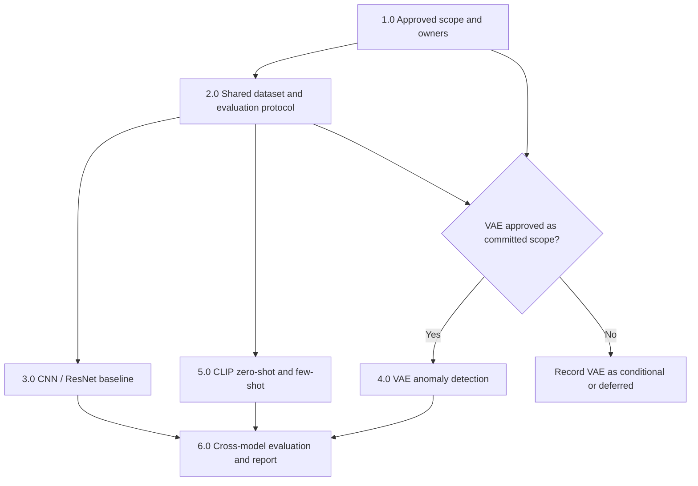

# Work Breakdown Structure (WBS): CNN, VAE, and CLIP

**Project:** Wildfire Detection in Drone Imagery with Little or No Labeled Data  
**Team:** The Visionaries — University of St. Thomas, SEIS 766, Fall 2026  
**Version:** 0.1 — Proposed for team review  
**Prepared:** November 12, 2026  
**Branch:** `Project-Management`  
**Companion:** [01-project-charter.md](01-project-charter.md)

> **Purpose.** This deliverable-oriented WBS decomposes the project's supervised CNN, VAE anomaly detection, and CLIP experiments into reviewable work packages, together with their shared prerequisites and research reporting. It describes **work to be completed**, not work already accomplished. All individual owners and reviewers are **TBD** until the group assigns them.
>
> **Scope gate:** CNN and CLIP constitute the minimum viable research comparison under the current repository roadmap. The charter proposes a VAE experiment but leaves its status as required versus conditional unresolved. **Approve VAE status at the Nov 16 scope review** and adjust the baseline accordingly; do not silently drop it.

## 1.0 Project coordination and scope baseline

| WBS ID | Work package / deliverable | Completion evidence / acceptance criteria | Dependency |
| --- | --- | --- | --- |
| **1.1** | Approved experimental scope | Team records mandatory CNN/CLIP and decides whether VAE is mandatory or conditional; excludes GAN augmentation unless separately approved | Project charter |
| **1.2** | Assigned workstream ownership | One owner and one peer reviewer recorded for data/QA, CNN, VAE (if approved), CLIP, and evaluation/reporting | 1.1 |
| **1.3** | Work tracking and collaboration plan | GitHub Issues or equivalent track each package, due dates, blockers, PRs, and review evidence; Drive/Colab responsibilities agreed | 1.2 |
| **1.4** | Approved research and evaluation protocol | Document labels, source partitions, validation strategy, few-shot budgets, seeds, common metrics, test-set isolation, and decision rules | 1.1, 2.3–2.5 |
| **1.5** | Risk, change and decision log | Data leakage, acquisition shift, access problems, compute constraints, schedule risks and scope changes have decisions/owners | 1.1 |

**Phase exit:** Scope, responsible persons and experiment protocol are approved and traceable to the charter. **Target review: Nov 16, 2026.**

## 2.0 Shared FLAME dataset and experiment foundation

All three model teams depend on these common artifacts. Build them **once** and reuse them rather than independently selecting different images or test sets.

| WBS ID | Work package / deliverable | Completion evidence / acceptance criteria | Dependency |
| --- | --- | --- | --- |
| **2.1** | Team data/compute access | Members confirm GitHub collaboration, Drive archives and Colab starter notebook access; blockers recorded | 1.3 |
| **2.2** | Archive inventory and QA report | Inspect `Training.zip` (39,375), `Test.zip` (8,617), `Images.zip` (2,003) and `Masks.zip` (2,003); record archive IDs/checksums where feasible, counts, decode checks and anomalies | 2.1 |
| **2.3** | Canonical image/label manifest | Manifest records sample IDs, archive/source, `Fire=1` / `No_Fire=0` mapping (after verification), label counts, file IDs/paths and known data limitations | 2.2 |
| **2.4** | Leakage-aware development split | Agree train/validation grouping for video-derived frames; record grouping evidence, seed and limitations; keep published Phantom test partition isolated | 2.3 |
| **2.5** | Shared labeling-budget protocol | Approve few-shot budgets (candidate: 0, 10, 25, 50, 100 **per class**, subject to team confirmation), reproducible samples, and how normal-only VAE training differs from few-shot classification | 2.4 |
| **2.6** | Reusable evaluation definitions | Specify classification metrics, thresholds, score orientation, false negatives, confusion matrices, sample IDs and reproducibility fields; use the same held-out sample IDs across models | 1.4, 2.3–2.5 |
| **2.7** | Segmentation mask audit (only for VAE localization) | Verify `Images`↔`Masks` pairing, mask value convention and image/mask dimensions; avoid cross-task test leakage; mark spatial metrics **not applicable** if this cannot be defended | 2.2; VAE localization approval |

**Controls:** Preserve original archives unchanged. Do not use held-out Phantom labels for training, prompt selection, threshold tuning or model selection. Video-derived frames are correlated; a random frame split is not automatically valid. Document the known mask dimension discrepancy and black test frames rather than silently adjusting the benchmark. **Data readiness should gate model training and any final test evaluation.**

## 3.0 Supervised CNN / ResNet workstream

**Objective:** Establish a reproducible full-supervision `Fire` vs `No_Fire` reference model. A reduced-label CNN variant is optional if the team approves a fair label-efficiency comparison.

| WBS ID | Work package / deliverable | Completion evidence / acceptance criteria | Dependency |
| --- | --- | --- | --- |
| **3.1** | CNN experiment specification | ResNet architecture/version, pretrained-weight source, training budget, preprocessing, hardware and evaluation settings documented | 1.4, 2.4 |
| **3.2** | CNN dataset loader | Reproducible Colab/PyTorch loader uses shared manifest/splits, mapped labels and approved train-only augmentation | 2.3–2.4 |
| **3.3** | Trainable supervised baseline | ResNet fine-tuning and validation pipeline runs with seed, tracked epochs/loss, environment and GPU details; checkpoint saved **outside GitHub** | 3.1–3.2 |
| **3.4** | Development-set evaluation | Validation fire-class precision, recall, F1, accuracy, confusion matrix and valid AUC metrics; selection documented using **validation only** | 3.3, 2.6 |
| **3.5** | Frozen CNN inference package | Selected checkpoint/configuration and repeatable `sample_id, score, prediction` output ready for one-time held-out evaluation | 3.4 |
| **3.6** | CNN result summary and failure examples | Methods, full-label supervision budget, compute cost and representative mistakes recorded; no claims of deployment validation | 3.4–3.5 |
| **3.7** | CNN reproducibility review | Peer-reviewed notebook/script and small configuration; colleague can rerun key training/inference stages | 3.1–3.6 |

**Workstream handoff:** reviewed notebook/code, configuration and checkpoint reference, validation metrics, frozen predictions and failure analysis. **Baseline checkpoint target: Nov 22, 2026.**

## 4.0 VAE anomaly-detection workstream — proposed, scope approval pending

**Objective:** Evaluate whether reconstruction-based anomaly scores from a VAE trained on identified `No_Fire` imagery help identify visible fires. The model uses **normal labels for sample selection**, so it must not be described as requiring no labeled data of any kind.

| WBS ID | Work package / deliverable | Completion evidence / acceptance criteria | Dependency |
| --- | --- | --- | --- |
| **4.1** | VAE scope gate and experiment specification | Team decides required/conditional status; documents image resolution, architecture, latent size, reconstruction/KL weighting, anomaly score and optional localization claim | 1.1, 1.4 |
| **4.2** | Verified normal-only training subset | Selected `No_Fire` examples come only from approved training partition; manifest/seed show normal-data selection and prevent held-out leakage | 2.3–2.5, 4.1 |
| **4.3** | VAE training pipeline and model | Reproducible encoder/decoder, variational training objective, training logs and checkpoint reference; abnormal/fire cases excluded from normal-only training | 4.2 |
| **4.4** | Anomaly scoring and calibration | Image-level reconstruction-error scoring, score orientation and threshold determined by an approved development-only procedure; explicitly record any fire labels used to calibrate thresholds | 4.3, 2.6 |
| **4.5** | Development-set evaluation | Validation confusion matrix, fire recall/precision/F1 and eligible AUC metrics, with false positives/negatives and ordinary-scene anomalies examined | 4.4 |
| **4.6** | Optional qualitative localization assessment | Error maps shown alongside samples; mask-based IoU **only if** independently valid image/mask pairs, split boundaries and localization method have been approved; otherwise qualitative evidence only | 2.7, 4.5 |
| **4.7** | Frozen VAE package and review | Versioned checkpoint reference, notebook, normal-example manifest, scoring config, selected threshold, frozen predictions, limitations and peer review | 4.1–4.6 |

**Workstream handoff (if approved):** trained VAE reference, normal-data manifest, scoring/threshold procedure, fire/no-fire evaluation, failure cases and optional clearly qualified heat maps. **Schedule:** integrate into the Dec 6 evaluation gate only if capacity and scope are approved; otherwise document as deferred/not completed.

## 5.0 CLIP zero-shot and few-shot workstream

**Objective:** Measure visible-fire classification with **zero FLAME-specific training labels** and investigate performance with a small number of FLAME examples. Pretrained CLIP has already learned from external image–text supervision, so zero-shot does **not** mean a model trained without any labels or prior supervision.

| WBS ID | Work package / deliverable | Completion evidence / acceptance criteria | Dependency |
| --- | --- | --- | --- |
| **5.1** | CLIP experiment specification | Model/checkpoint, preprocessing, `Fire` and `No_Fire` text prompts, inference method, score rules and approval of any prompt selection documented | 1.4, 2.6 |
| **5.2** | Zero-shot prediction pipeline | Runnable Colab notebook computes image–text similarity and produces per-image fire scores without FLAME task-specific training | 2.3–2.4, 5.1 |
| **5.3** | Zero-shot validation results | Record confusion matrix, accuracy, fire precision/recall/F1, eligible AUC metrics and prompt limitations using development data only | 5.2 |
| **5.4** | Few-shot protocol and sampling | Team approves budget(s), exact sampled IDs, seeds, class balance and method (e.g., **frozen CLIP embeddings + linear probe**); no Phantom test labels used | 2.5, 5.1 |
| **5.5** | Few-shot classifier and validation | Train/evaluate approved classifier on sampled development examples; preserve same evaluation protocol and distinguish each label budget from zero-shot | 5.4 |
| **5.6** | Frozen CLIP inference package | Final prompts, model/configuration, few-shot sample IDs, trained probe references, thresholds and repeatable `sample_id, score, prediction` outputs | 5.3, 5.5 |
| **5.7** | CLIP result summary and reproducibility review | Zero-shot/few-shot tables, label-efficiency observations, false alarms/misses, compute and limitations; reviewed notebook/configuration | 5.1–5.6 |

**Workstream handoff:** frozen prompts, versioned CLIP configuration, zero-shot scores, few-shot sampling/probe artifacts, validation metrics, failure analysis and reproducible notebook. **Zero-shot demonstration target: Nov 23–29; comparison freeze target: Dec 6.**

## 6.0 Cross-model comparison, reporting, and closure

| WBS ID | Work package / deliverable | Completion evidence / acceptance criteria | Dependency |
| --- | --- | --- | --- |
| **6.1** | Comparable model-output package | Agree score orientation, label mapping, held-out sample IDs and prediction file schema across CNN/CLIP and VAE if approved; report **different supervision budgets** explicitly | 2.6, 3.5, 5.6; 4.7 if approved |
| **6.2** | Locked model-selection register | Model versions, prompts, thresholds, training budgets and seeds frozen **before** held-out evaluation; any departures documented | 6.1 |
| **6.3** | Final held-out cross-acquisition evaluation | Use published Phantom test only after freezing; record per-model accuracy, precision, recall, F1, confusion matrices, balanced accuracy and eligible ROC-AUC/AP; same test examples across methods | 6.2 |
| **6.4** | Error, limitations and efficiency analysis | Compare missed fires/false alarms, acquisition differences, data correlation, prescribed-burn limits, inference time and compute; no claim that camera differences alone caused outcomes | 6.3 |
| **6.5** | Label-efficiency comparison | Compare zero-shot and agreed few-shot label budgets with full-label CNN reference; show no-label, normal-only and supervised protocols separately instead of claiming direct supervision equivalence | 3.6, 5.7; 4.7 if approved |
| **6.6** | Presentation deck and review | Research question, methodology, selected results, charted comparisons, failures and limitations reviewed by team | 6.3–6.5 |
| **6.7** | Reproducibility and final report package | Peer-reviewed notebooks/code, references, data provenance, split manifests, configurations, metrics, summary visuals and team contributions; no raw data/weights/secrets committed to GitHub | 6.3–6.6 |
| **6.8** | Final acceptance and submission | Internal review/approval and submission according to confirmed Canvas dates, with any unfinished VAE/extension scope transparently declared | 6.7 |

**Milestone targets from the charter (verify official course dates):**

| Date | Gate | Key WBS packages |
| --- | --- | --- |
| **Nov 16** | Approve scope, owners, research protocol | 1.1–1.5, 2.3–2.5 |
| **Nov 22** | Demonstrate initial baseline | 2.4–2.6, 3.1–3.4 |
| **Nov 23–29** | Develop CLIP and refine baseline | 3.5–3.7, 5.1–5.3 |
| **Dec 6** | Freeze evaluation/model selection | 5.4–5.7, 4.x if approved, 6.1–6.2 |
| **Dec 8 (tentative)** | Group presentation | 6.3–6.6 |
| **Dec 15 (internal)** | Freeze delivery package | 6.7 |
| **Dec 19 (tentative)** | Final project submission | 6.8 |

## Work package controls and definition of done

Each WBS work package should be entered into GitHub Issues or another shared tracker with:

- **Owner / reviewer:** named individuals, assigned by the team; no roles are presumed by this WBS.
- **Status:** not started / in progress / blocked / in review / accepted (do not infer completion from a plan).
- **Target:** milestone and dependency, plus any agreed due date.
- **Evidence:** linked pull request, manifest, notebook, validated metrics or report section.
- **Acceptance:** a reviewer can independently verify its completion criteria and confirm that test data were not used for tuning.

### Cross-workstream dependency flow

### Final research acceptance conditions

A complete minimum viable research project has: (1) documented and leakage-aware development partitions, (2) a reproducible **CNN baseline**, (3) a reproducible **CLIP comparison**, (4) one frozen held-out evaluation with fire-class failure analysis and declared supervision budgets, and (5) a reviewed presentation/report. Include VAE results **only if the team formally approves the workstream and the experiment is completed**; any decision to defer it should be recorded against the charter.

**Exclusions from this WBS:** operational fire alert deployment, new UAV data collection, thermal/video tracking, production latency guarantees, a separately trained segmentation model, and GAN-generated fire-image augmentation without additional scope approval.

---

**Source:** [Project charter](01-project-charter.md) and [repository research plan](../README.md). **Status:** draft planning decomposition; it does not assert implementation or milestone completion.
